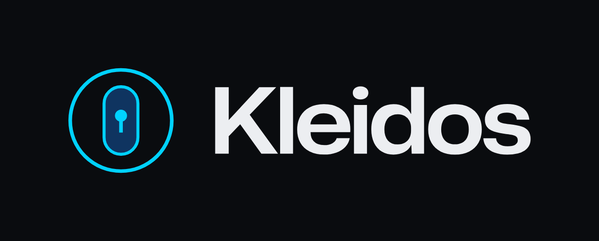

# brand

The identity of [Kleidos](https://kleidos.dev), free firmware that turns a small ESP32 board into a hardware password manager: its logo, its typefaces, its colors, the tokens the site and the device are styled with, what may be said about the project, and a press kit.

**Writing about Kleidos?** Go to [`press-kit/`](press-kit/). Use any file there as it is; editorial use needs no permission, and the only thing asked is to leave the mark unaltered.



## What is where

| Folder | What it holds |
| --- | --- |
| [`logo/`](logo/) | The mark (a keyhole inside its ring, always whole), its small version for sizes under 24 px, the horizontal and stacked lockups, the name's lettering; as SVG, PNG and WebP, for dark and light grounds, in color and in one ink, on transparency and flattened on white or black; the rules of use |
| [`fonts/`](fonts/) | Mona Sans and Mona Sans Mono (the brand and the web), Inter and JetBrains Mono (the device), unmodified, with their licenses and pins |
| [`tokens/`](tokens/) | `tokens.json`, the one file of values, and what is generated from it: a flat color list and a stylesheet |
| [`colors/`](colors/) | The palette with each color's role, its values for screen and print, and measured contrast |
| [`about/`](about/) | `facts.json` and the project described in one line, one paragraph and one page, with a page on the name and its history, in English and Spanish |
| [`kicad/`](kicad/) | The Kleidos KiCad style: the drawing sheet with the mark in its title block and the color theme, for a dark and a light ground, the numbers and rules every Kleidos schematic is drawn to, the helper that runs kicad-cli with them, and the tool that copies the kit into the repositories that draw with it |
| [`boards/`](boards/) | The nine boards' fronts, copied from the [`boards`](https://github.com/kleidos-dev/boards) repository with the commit they were taken at, for the line-up images |
| [`press-kit/`](press-kit/) | Ready images (16:9, 1:1 and 4:5, dark and light, English and Spanish), the nine boards at one scale on their unlock screens, real captures of the product's screens, a photograph of four boards running Kleidos, a fact sheet, and how all of it may be used |
| [`tools/`](tools/), [`tests/`](tests/) | The builder, the checks and their tests |

## Building

Every image and every generated file comes from a few sources: `logo/src/mark.svg` (the only drawing kept by hand), `logo/src/lockups.json`, `logo/src/small-mark.json`, `logo/src/opaque.json`, `tokens/tokens.json`, the fonts, the templates and words under `press-kit/src/`, the screen captures, the photographs, the board fronts under `boards/`, and `kicad/src/style.json` with the KiCad kit's fixture.

```sh
python3 -m venv .venv
.venv/bin/pip install -r requirements.txt
.venv/bin/python -m playwright install chromium

.venv/bin/python tools/build.py                     # regenerate everything
.venv/bin/python tools/build.py --check             # draw everything again, compare pixel for pixel
.venv/bin/python tools/build.py --check --static    # what needs no browser
.venv/bin/python tools/build.py --check --tolerant  # draw again under any browser, fail on gross drift
.venv/bin/python tools/check.py                     # the tree's rules
.venv/bin/python -m pytest tests
.venv/bin/reuse lint
.venv/bin/python tools/build.py --zip               # dist/kleidos-press-kit.zip, not committed
.venv/bin/python tools/sync_from_boards.py --copy <boards checkout>   # copy the fronts again, with the commit
.venv/bin/python tools/build.py --kicad             # also draw the KiCad kit's previews (needs kicad-cli 10.0.8)
.venv/bin/python tools/sync_kicad.py --copy <kit folder>     # hand the KiCad kit to boards or the meter, with KIT.json
```

Python 3.15. Pictures are drawn by Playwright's Chromium, headless, from SVG files that hold outlines only (no picture depends on an installed font), and re-encoded from their pixels alone. The small marks are the exception: each of their pixels is counted from the fit (its alpha is the share of 256 sample points inside the shapes), so their PNG files are the same bytes on every machine. Every PNG and JPEG file also comes as WebP, encoded by Pillow's pinned libwebp from its decoded pixels (lossless for the artwork and the captures, quality 90 for the photograph), and every logo PNG on transparency also comes flattened on white or black. `exports.json` records the browser's version, the WebP encoder's version and settings, and what each picture was drawn from. Every published picture and SVG also says what it is, for desktop tools and indexers alike: title, description, alt text, author, copyright line, license with its URL, keywords, its public URL and how it was made, in XMP and the format's own slots (PNG text, IPTC in the JPEG files, the XMP chunk of the WebP files, Dublin Core in the SVG files), written by the builder from one record per file (`tools/kleidos_brand/meta.py`) and checked by `tools/check_metadata.py`. The exact comparison is the exporting machine's: another Chromium draws an edge a shade apart, so `--check` refuses to compare under a different version, and CI runs the static and the tolerant checks.

The [`social`](https://github.com/kleidos-dev/social) repository takes this one as a submodule and imports `tools/kleidos_brand/` from it, so both draw with one set of rules, one browser and one encoder.

## License

The artwork (the mark, the lockups, the press images, the screen captures, the photographs, the palette's sheet) is licensed under the [GNU General Public License, version 3 or any later version](LICENSE) (GPL-3.0-or-later), the firmware's license. What is more useful to everyone under a permissive license is under the [MIT License](LICENSES/MIT.txt): the tokens and the files generated from them, the tools, tests and CI, the texts under `about/` and the fact sheets, which anyone may quote freely, and the board fronts copied from the `boards` repository. The fonts are their authors', under the [SIL Open Font License 1.1](LICENSES/OFL-1.1.txt). All three are approved by the Open Source Initiative. Details and credits: [`NOTICE.md`](NOTICE.md); file by file: `REUSE.toml`.

Kleidos is not a registered trademark. As section 7(e) of the GPL allows, no license here grants rights under trademark law in the name "Kleidos" or in the Kleidos mark. As section 7(c) allows, a modified version of a file under the GPL here must be marked as different from the original and must not misrepresent its origin; a file passed on unchanged needs nothing. [`TRADEMARKS.md`](TRADEMARKS.md) says what that means, gives the permission that lets anyone republish the logo and the press kit as they are, and states what the project asks of those who use its name.

## Contact

mail@kleidos.dev. Kleidos is made by José M. Requena Plens (<https://github.com/jmrplens>). The project's repositories are in the [kleidos-dev](https://github.com/kleidos-dev) organization.
