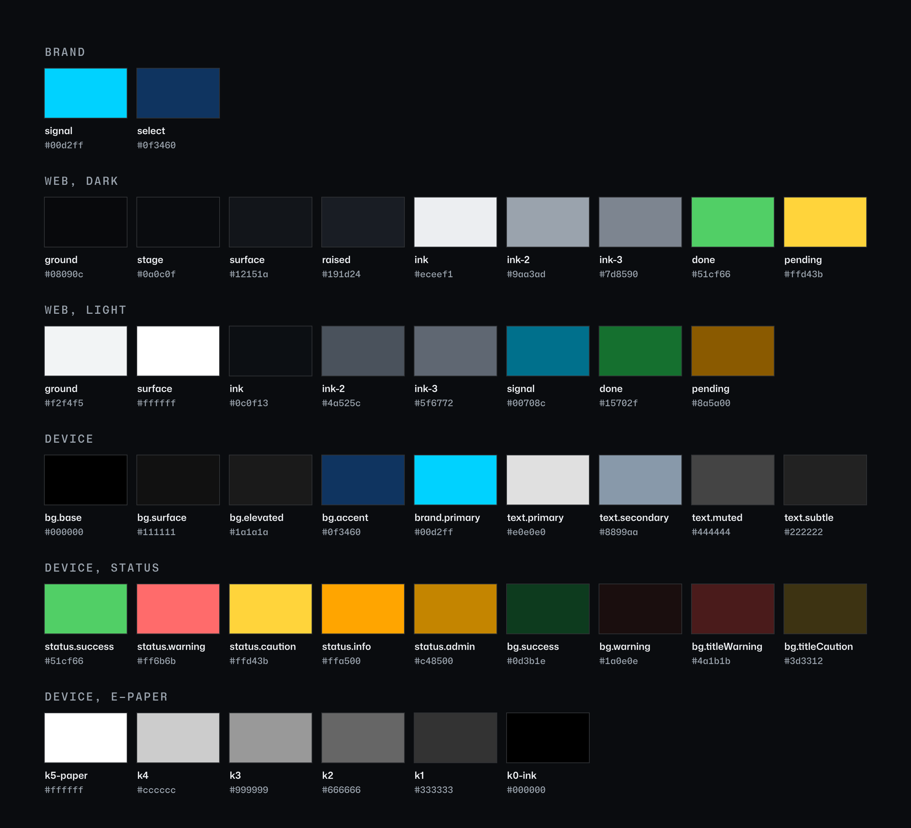

# Colors

Two colors make the mark: `signal`, the cyan of its ring and keyhole, and `select`, the deep blue of its body. Everything else is ground and ink. The values live in [`../tokens/tokens.json`](../tokens/tokens.json); this page and the swatch sheet are generated from it.

## Rules

- True colors: a color is used at its value, never tinted, shaded or made translucent. Where a hairline is wanted, `social.rule` is the one computed color (the ink at 16 % over the ground, as a solid).
- One job per color. `signal` marks what can be pressed and what is current; it is not decoration. `done` and `pending` are statuses and always stand beside their word.
- The mark keeps its own colors on every ground. The darker `web.light.signal` is for words and controls on a light page, never for the mark.
- On a light ground `signal` is 1.80:1: never small text there.

## Values

RGB is the color as a screen shows it (sRGB). The CMYK column is arithmetic from those values with no press profile applied: it is where a proof starts, not what a press will print, and `signal` in particular lies outside what four-color print reaches. Ask the printer for a proof.

<!-- BEGIN GENERATED: roles (tools/build.py); do not edit by hand -->

| Token | Hex | RGB | CMYK, by arithmetic | Role |
| --- | --- | --- | --- | --- |
| `brand.signal` | `#00d2ff` | 0, 210, 255 | 100, 18, 0, 0 | The mark's ring and keyhole; what can be pressed; the device's own cyan |
| `brand.select` | `#0f3460` | 15, 52, 96 | 84, 46, 0, 62 | The mark's body; the fill of a selection |
| `web.dark.ground` | `#08090c` | 8, 9, 12 | 33, 25, 0, 95 | The page |
| `web.dark.stage` | `#0a0c0f` | 10, 12, 15 | 33, 20, 0, 94 | The stage: dark in both themes, because the captures are encoded against black |
| `web.dark.surface` | `#12151a` | 18, 21, 26 | 31, 19, 0, 90 | A card |
| `web.dark.raised` | `#191d24` | 25, 29, 36 | 31, 19, 0, 86 | A table head, a pressed or hovered control |
| `web.dark.ink` | `#eceef1` | 236, 238, 241 | 2, 1, 0, 5 | Text |
| `web.dark.ink-2` | `#9aa3ad` | 154, 163, 173 | 11, 6, 0, 32 | Secondary text: ledes, captions |
| `web.dark.ink-3` | `#7d8590` | 125, 133, 144 | 13, 8, 0, 44 | Tertiary text: labels, dates |
| `web.dark.done` | `#51cf66` | 81, 207, 102 | 61, 0, 51, 19 | A status met, always beside its word |
| `web.dark.pending` | `#ffd43b` | 255, 212, 59 | 0, 17, 77, 0 | A status not met yet, always beside its word |
| `web.light.ground` | `#f2f4f5` | 242, 244, 245 | 1, 0, 0, 4 |  |
| `web.light.surface` | `#ffffff` | 255, 255, 255 | 0, 0, 0, 0 |  |
| `web.light.ink` | `#0c0f13` | 12, 15, 19 | 37, 21, 0, 93 |  |
| `web.light.ink-2` | `#4a525c` | 74, 82, 92 | 20, 11, 0, 64 |  |
| `web.light.ink-3` | `#5f6772` | 95, 103, 114 | 17, 10, 0, 55 |  |
| `web.light.signal` | `#00708c` | 0, 112, 140 | 100, 20, 0, 45 | The accent on a light ground, for text and controls; never the mark |
| `web.light.done` | `#15702f` | 21, 112, 47 | 81, 0, 58, 56 |  |
| `web.light.pending` | `#8a5a00` | 138, 90, 0 | 0, 35, 100, 46 |  |
| `device.dark.bg.base` | `#000000` | 0, 0, 0 | 0, 0, 0, 100 | Device screen full-screen background |
| `device.dark.bg.surface` | `#111111` | 17, 17, 17 | 0, 0, 0, 93 | Cards, headers, dialogs |
| `device.dark.bg.elevated` | `#1a1a1a` | 26, 26, 26 | 0, 0, 0, 90 | Raised interactive key face (on-screen keyboard); one step above bg.surface |
| `device.dark.bg.accent` | `#0f3460` | 15, 52, 96 | 84, 46, 0, 62 | Selected / focused row background |
| `device.dark.brand.primary` | `#00d2ff` | 0, 210, 255 | 100, 18, 0, 0 | Cyan — logo, CTA, focus, cursor |
| `device.dark.text.primary` | `#e0e0e0` | 224, 224, 224 | 0, 0, 0, 12 |  |
| `device.dark.text.secondary` | `#8899aa` | 136, 153, 170 | 20, 10, 0, 33 |  |
| `device.dark.text.muted` | `#444444` | 68, 68, 68 | 0, 0, 0, 73 |  |
| `device.dark.text.subtle` | `#222222` | 34, 34, 34 | 0, 0, 0, 87 | Dividers, inactive table borders |
| `device.dark.status.success` | `#51cf66` | 81, 207, 102 | 61, 0, 51, 19 | Confirmations, healthy state, success toasts |
| `device.dark.status.warning` | `#ff6b6b` | 255, 107, 107 | 0, 58, 58, 0 | Destructive actions, errors, alerts |
| `device.dark.status.caution` | `#ffd43b` | 255, 212, 59 | 0, 17, 77, 0 | Reversible-destructive, lockout, attention |
| `device.dark.status.info` | `#ffa500` | 255, 165, 0 | 0, 35, 100, 0 | Neutral info, non-critical notices |
| `device.dark.status.admin` | `#c48500` | 196, 133, 0 | 0, 32, 100, 23 | Admin-mode persistent banner (yellow/amber) |
| `device.dark.bg.success` | `#0d3b1e` | 13, 59, 30 | 78, 0, 49, 77 | Success container — the dark fill a light foreground sits on, paired with a status.success ring. Never a text color |
| `device.dark.bg.warning` | `#1a0e0e` | 26, 14, 14 | 0, 46, 46, 90 | Alert / destructive container — the dark fill a light foreground sits on, paired with a status.warning ring. Never a text color |
| `device.dark.bg.titleWarning` | `#4a1b1b` | 74, 27, 27 | 0, 64, 64, 71 | Destructive popup title bar — the dark tint of status.warning the icon and title of a card that asks for something sit on. Never a text color |
| `device.dark.bg.titleCaution` | `#3d3312` | 61, 51, 18 | 0, 16, 70, 76 | Caution popup title bar — the dark tint of status.caution the icon and title sit on. Never a text color |
| `device.eink.k5-paper` | `#ffffff` | 255, 255, 255 | 0, 0, 0, 0 | Base |
| `device.eink.k4` | `#cccccc` | 204, 204, 204 | 0, 0, 0, 20 | Fill, dither 25 % |
| `device.eink.k3` | `#999999` | 153, 153, 153 | 0, 0, 0, 40 | Icon, dither 50 % |
| `device.eink.k2` | `#666666` | 102, 102, 102 | 0, 0, 0, 60 | Secondary text |
| `device.eink.k1` | `#333333` | 51, 51, 51 | 0, 0, 0, 80 |  |
| `device.eink.k0-ink` | `#000000` | 0, 0, 0 | 0, 0, 0, 100 | Body |

<!-- END GENERATED: roles -->

## Measured contrast

WCAG 2 contrast ratios, computed by `tools/kleidos_brand/tokens.py` from the values above.

<!-- BEGIN GENERATED: contrast (tools/build.py); do not edit by hand -->

| Color | On | Contrast | What the pair is |
| --- | --- | --- | --- |
| `brand.signal` `#00d2ff` | `web.dark.stage` `#0a0c0f` | 10.88:1 | the mark's ring on the brand's ground |
| `brand.signal` `#00d2ff` | `web.dark.ground` `#08090c` | 11.06:1 | the accent on the site's page |
| `brand.signal` `#00d2ff` | `device.dark.bg.base` `#000000` | 11.66:1 | the accent on a panel's black |
| `brand.signal` `#00d2ff` | `brand.select` `#0f3460` | 6.94:1 | the keyhole on the mark's body |
| `brand.signal` `#00d2ff` | `web.light.surface` `#ffffff` | 1.80:1 | the mark's ring on white: the body carries the mark there |
| `brand.select` `#0f3460` | `web.light.surface` `#ffffff` | 12.50:1 | the mark's body on white |
| `brand.select` `#0f3460` | `web.dark.stage` `#0a0c0f` | 1.57:1 | the mark's body on the brand's ground: never a line on dark |
| `web.dark.ink` `#eceef1` | `web.dark.stage` `#0a0c0f` | 16.85:1 | names and titles on the brand's ground |
| `web.dark.ink` `#eceef1` | `web.dark.ground` `#08090c` | 17.13:1 | text on the site's page |
| `web.dark.ink-2` `#9aa3ad` | `web.dark.stage` `#0a0c0f` | 7.66:1 | second lines on the brand's ground |
| `web.dark.ink-3` `#7d8590` | `web.dark.ground` `#08090c` | 5.34:1 | labels on the site's page |
| `web.dark.done` `#51cf66` | `web.dark.ground` `#08090c` | 9.92:1 | a status met |
| `web.dark.pending` `#ffd43b` | `web.dark.ground` `#08090c` | 13.97:1 | a status not met yet |
| `web.light.signal` `#00708c` | `web.light.ground` `#f2f4f5` | 5.15:1 | the accent on the light page |
| `web.light.signal` `#00708c` | `web.light.surface` `#ffffff` | 5.68:1 | the accent on white |
| `web.light.ink` `#0c0f13` | `web.light.ground` `#f2f4f5` | 17.41:1 | text on the light page |
| `web.light.ink-2` `#4a525c` | `web.light.ground` `#f2f4f5` | 7.18:1 | second lines on the light page |
| `web.light.ink-3` `#5f6772` | `web.light.ground` `#f2f4f5` | 5.19:1 | labels on the light page |
| `device.dark.text.primary` `#e0e0e0` | `device.dark.bg.base` `#000000` | 15.91:1 | text on a panel |
| `device.dark.text.secondary` `#8899aa` | `device.dark.bg.base` `#000000` | 7.18:1 | hints on a panel |
| `device.dark.status.success` `#51cf66` | `device.dark.bg.base` `#000000` | 10.47:1 | success |
| `device.dark.status.warning` `#ff6b6b` | `device.dark.bg.base` `#000000` | 7.57:1 | warning |
| `device.dark.status.caution` `#ffd43b` | `device.dark.bg.base` `#000000` | 14.73:1 | caution |
| `device.dark.status.info` `#ffa500` | `device.dark.bg.base` `#000000` | 10.63:1 | info |
| `device.dark.status.admin` `#c48500` | `device.dark.bg.base` `#000000` | 6.70:1 | the admin banner |

<!-- END GENERATED: contrast -->

## The device's palette

What the firmware's dark panels draw, with the 16-bit value a panel stores and the constant that holds each color in the firmware's `src/ui/core/theme.h`.

<!-- BEGIN GENERATED: device (tools/build.py); do not edit by hand -->

| Token | Hex | RGB565 | Constant in `theme.h` |
| --- | --- | --- | --- |
| `device.dark.bg.base` | `#000000` | `0x0000` | `kBg` |
| `device.dark.bg.surface` | `#111111` | `0x1082` | `kSurface` |
| `device.dark.bg.elevated` | `#1a1a1a` | `0x18C3` | `kElevated` |
| `device.dark.bg.accent` | `#0f3460` | `0x09AC` | `kAccent` |
| `device.dark.bg.success` | `#0d3b1e` | `0x09C3` | `kSuccessFill` |
| `device.dark.bg.warning` | `#1a0e0e` | `0x1861` | `kWarningFill` |
| `device.dark.bg.titleWarning` | `#4a1b1b` | `0x48C3` | `kWarningTitle` |
| `device.dark.bg.titleCaution` | `#3d3312` | `0x3982` | `kCautionTitle` |
| `device.dark.brand.primary` | `#00d2ff` | `0x069F` | `kPrimary` |
| `device.dark.text.primary` | `#e0e0e0` | `0xE71C` | `kText` |
| `device.dark.text.secondary` | `#8899aa` | `0x8CD5` | `kTextSec` |
| `device.dark.text.muted` | `#444444` | `0x4228` | `kMuted` |
| `device.dark.text.subtle` | `#222222` | `0x2104` | `kSubtle` |
| `device.dark.status.success` | `#51cf66` | `0x566C` | `kSuccess` |
| `device.dark.status.warning` | `#ff6b6b` | `0xFB4D` | `kWarning` |
| `device.dark.status.caution` | `#ffd43b` | `0xFEA7` | `kLockout` |
| `device.dark.status.info` | `#ffa500` | `0xFD20` | `kInfo` |
| `device.dark.status.admin` | `#c48500` | `0xC420` | `kAdmin` |

<!-- END GENERATED: device -->

The CoreInk's e-paper draws white, four grays and black. The grays are ordered dither, never solid fills, and nothing there is anti-aliased.
