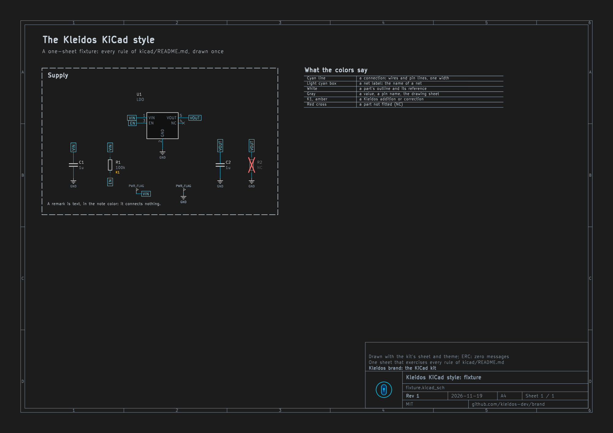
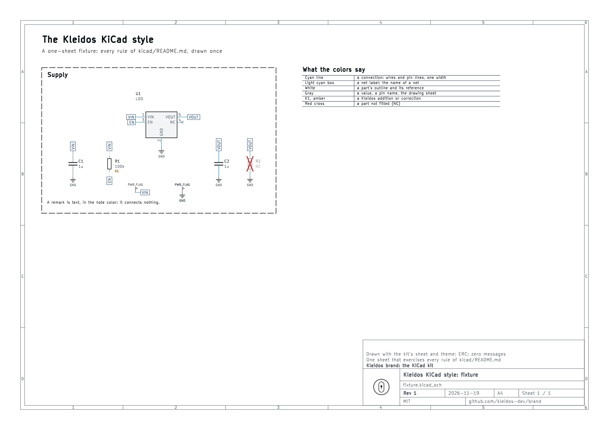

<!--
SPDX-FileCopyrightText: 2026 José M. Requena Plens
SPDX-License-Identifier: MIT
-->

# The Kleidos KiCad style

One look for every Kleidos schematic: the drawing sheet with the Kleidos mark in its title block, the color theme, and the rules below, owned here and drawn alike by [`boards`](https://github.com/kleidos-dev/boards) (the nine boards' schematics) and the bench meter. KiCad 10 (kicad-cli 10.0.8, the `kicad/kicad:10.0.8` container CI uses).





## What is here

| File | What it is | Made |
| --- | --- | --- |
| `src/style.json` | The style's numbers: the sheet's geometry, the mark's size, the sizes and widths, which KiCad key takes which role, the font choice | by hand |
| `src/stroke-advances.json` | KiCad's stroke font, each character's advance per unit of size, measured with kicad-cli: how a generator knows a line's width before KiCad would condense it | measured |
| `kleidos-dark.kicad_wks`, `kleidos-light.kicad_wks` | The drawing sheet of each ground: KiCad's default frame and zone grid with the Kleidos title block, the mark embedded as `logo/png/kleidos-mark-1024.png` (dark) or `logo/png/kleidos-mark-ink-dark-1024.png` (light), unchanged | `tools/build.py` |
| `kleidos-dark.json`, `kleidos-light.json` | The color theme of each ground, every value a token of the `schematic` group of `tokens/tokens.json` | `tools/build.py` |
| `style.json` | `src/style.json` with every role resolved to its color and the stroke font's advances, for the generators | `tools/build.py` |
| `kleidos_kicad.py` | The one way to run kicad-cli with the kit, the same in every repository | by hand |
| `fixture/` | One A4 sheet that exercises every rule below, with its project file | by hand |
| `preview/` | The fixture drawn on each ground, as PNG and WebP | `tools/build.py --kicad` |

The generated files are never edited: change `src/style.json`, the tokens or the mark and build again. `tools/check.py` holds every theme color to a token, each sheet to its logo file's bytes, and no font or color in a sheet.

## Using the kit

A repository that draws with the kit takes byte copies of `kleidos-*.kicad_wks`, `kleidos-*.json`, `style.json` and `kleidos_kicad.py`, with a manifest, from a checkout of this repository:

```sh
.venv/bin/python tools/sync_kicad.py --copy ../boards/_shared/kicad     # writes the kit and KIT.json
.venv/bin/python tools/sync_kicad.py --check ../boards/_shared/kicad    # is it this checkout's kit?
```

`KIT.json` names the kit's version (`kleidos-kicad/1`), this repository's address, the commit the files were taken at and each file's SHA-256. The consumer's own test holds every file of its kit folder to that manifest, with no brand checkout. Copies, not a submodule: a consumer stays whole in a plain clone and in the KiCad container, and brand already copies the board fronts from `boards`.

Its generator reads `style.json` for every number it would otherwise hold as a literal, writes the `.kicad_pro` with `page_layout_descr_file` (the kit's dark sheet, relative to the project), the text variables `LICENSE` and `SOURCE_URL` and the one line width, and refuses a title-block line wider than its cell. Its exporter goes through `kleidos_kicad.py`:

```python
import kleidos_kicad as kit

env = kit.environment()  # English, both themes, a settings folder of its own
count, report = kit.erc(schematic, env)  # the style allows no message
kit.export_pdf(schematic, pdf, env, "dark")  # theme, sheet and face of the ground
kit.export_svg(schematic, folder, env, "dark")
kit.svg_findings(svg, "dark")  # the theme's background, one wire width
kit.pdf_findings(reader, "dark")  # the mark once per page, one image object
kit.sort_fonts(writer)  # before a pypdf rewrite, for the same bytes every run
kit.cell_findings([("title", title), ("comments", line)])  # a title-block line wider than its cell
```

A light export runs on a copy of the sources made with `kit.recolor(text, "light")`, which turns the two explicit colors (the addition marker, a table's rules) to the light ground's; the committed sources are always the dark ground.

## The rules

### Sheet and title block

- KiCad's default geometry, unchanged, so every `[page/zone]` reference and keep-out holds: margins of 10 mm, the frame's two rectangles 2 mm apart, zone ticks and figures every 50 mm (columns from 1, rows from A) on all four sides, the title block 108 x 32 mm, 2 mm inside the frame's corner.
- The title block: four comment lines and the company line (bold) across the top; under them, the mark in an 18 mm cell, then title (1.75 bold), file, revision (bold), date, paper, sheet n / N, license (the SPDX identifier) and source address, each in its own cell. Every text sits 1.5 mm inside its cell and carries a `maxlen` as a net; a generator refuses a line that would be condensed (`kleidos_kicad.cell_findings`, from the measured advances).
- The values come from the project: title, date, revision, company and comments from each sheet's `title_block`, `LICENSE` and `SOURCE_URL` from the `.kicad_pro`'s text variables. The KiCad version is not printed: it stays in the PDF's `/Creator`.
- No color and no font in the sheet: every line and text takes the theme's `worksheet` color, so one layout serves both grounds; emphasis is weight and size only.

### The mark

- Brand's own PNG, placed unchanged as the sheet's bitmap: the mark in color on the dark sheet, the one-ink dark mark on the light sheet (the color mark's ring is 1.80:1 on white). 9 mm of mark in its 18 mm cell: over the 6 mm print minimum, with the full clear space.
- In the title block, on every page; never redrawn, recolored or replaced by the lockup. In a PDF it is one image with its soft mask, stored once for every page.

### Colors

Dark is published and committed; light is the print companion, exported on demand. Each role is a token, `schematic.<ground>.<role>`:

| Role | Dark | Light | KiCad keys |
| --- | --- | --- | --- |
| ground | `#1c1c1c` | `#ffffff` | `background` |
| wire | `#00d2ff` | `#00708c` | `wire`, `bus`, `junction`, `bus_junction`, `pin` |
| body | `#111111` | `#f2f4f5` | `component_body` |
| ink | `#e0e0e0` | `#0c0f13` | `component_outline`, `reference`, `sheet_name` |
| ink-2 | `#8899aa` | `#4a525c` | `fields`, `value`, `pin_name`, `pin_number`, `no_connect`, `netclass_flag`, `private_note`, `sheet`, `sheet_fields`, `sheet_filename`, `worksheet` |
| faint | `#444444` | `#d8d9d9` | `grid`, `hidden`, `page_limits` |
| label | `#7fe6ff` | `#0f3460` | `label_global`, `label_hier`, `label_local`, `sheet_label` |
| note | `#c8d2dc` | `#0c0f13` | `note` |
| dnp | `#ff6b6b` | `#c92a2a` | `dnp_marker` |
| addition | `#ffb800` | `#8a5a00` | none: written by the generator as an explicit color |
| rule | `#8899aa` | `#4a525c` | none: written by the generator as an explicit color |

`override_item_colors` stays false, so the two explicit colors survive. What the reader is told: cyan lines are connections, white the parts and their references, gray the values and pin names, a label's lighter cyan its box, amber a Kleidos addition or correction, the red cross a part not fitted.

### Type

One typeface per drawing: the sheets name no face, so text takes KiCad's default font, or the one `--default-font` names; `style.json`'s `font.family` holds the choice and the helper passes it. Kit version 1 keeps KiCad's own lettering (`null`). Sizes are KiCad's nominal size, the cap height:

| Role | Size (mm) | Weight | Where |
| --- | --- | --- | --- |
| body | 1.27 | regular | pin names and numbers, references, values, labels, notes, table cells |
| small | 1.0 | regular; bold for the K ids | `[page/zone]` references, the addition markers, a flag's value |
| sheet | 1.5 | regular; bold for company and revision | title-block fields, the page row; 1.3 for the zone figures |
| running | 1.75 | regular; bold for the title-block title | a contents page's text, the title-block title |
| section | 2.0 | bold | a block's title, a panel's title |
| heading | 3.0 | bold | a page's heading |

Line pitch 1.7 times the size; table rows 2.54 mm.

### Lines, grid and symbols

| Thing | Value |
| --- | --- |
| Grid | 1.27 mm; pins on a 2.54 mm pitch; nothing connectable off the grid |
| Connections | one width, 6 mil (0.1524 mm): wires, pin lines, the project's default line and its netclass (the width kicad-cli gives a symbol's pins whatever the project says) |
| Bus | 12 mil |
| Symbol body | 0.254 mm outline, the theme's body fill |
| Pin | 2.54 mm long (longer only where the pin numbers are wide), names inside, numbers above |
| Stub | 2.54 mm from a pin to its label |
| Block frame | 0.254 mm dashed, its title at 2.0 bold inside the top left |
| Table rule | 0.2 mm, in the rule color |
| Junction | KiCad's default dot, in the wire color |
| Added connection | dotted, at the one width |
| Symbols | each project's own; no KiCad library is read |

Brand owns the look; the drawings own their symbols: the generic library is the boards generator's, and every other drawing draws its own by the same rules.

### Nets, labels, power and marks

- A net name is a label that connects: a global label, shape passive, at the end of a stub or on a wire. A remark is text in the note color, never a label.
- Rails are labels with the name the documentation prints; grounds are symbols; a `PWR_FLAG` goes where ERC needs one. Every pin ends in a label, a wire, a ground or a no-connect cross.
- A part not fitted carries KiCad's DNP mark. A Kleidos addition or correction carries its id (`K3`), bold, small, in the addition color, which nothing else takes.
- ERC: zero messages, errors and warnings alike. An ignored rule is named in the project file and explained in the drawing's README.
- A drawing that connects by labels prints after each label the `[page/zone]` of the net's other pages; a drawing that connects by wires draws them orthogonal at the one width, with a label wherever the net has a name worth reading.
- A multi-page drawing has a contents page, its drawing pages and its index pages, links that land on the place and bookmarks; a one-page drawing puts its notes and revision history on the page as panels with 2.0 bold titles.

## Licenses

The two sheets and the previews hold the mark: they are artwork, GPL-3.0-or-later, like the rest of the logo files. Everything else here (`src/style.json`, `style.json`, the two themes, `kleidos_kicad.py`, `fixture/`, this page) is under the MIT License with the tokens and the tooling. A drawing made with the kit keeps its own repository's license: it shows the mark placed unchanged under the press permission of [`TRADEMARKS.md`](../TRADEMARKS.md), and its metadata credits it.
